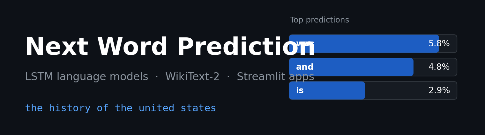
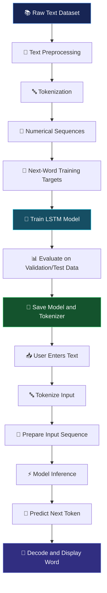
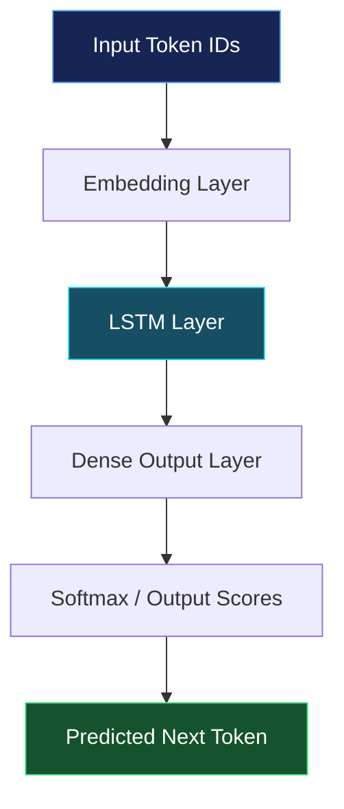

<div align="center"> 

<h1>🧠 Next Word Prediction Using LSTM</h1>

<p>
  <strong>Predict the next word. Explore language patterns. Build with deep learning.</strong>
</p>

<p>
  An end-to-end Natural Language Processing project that uses a trained
  Long Short-Term Memory (LSTM) neural network to predict the next word
  from a user-provided text sequence.
</p>

<p>
  <a href="https://github.com/pranavmaheshwari15/next_word_prediction_final">
    
  </a>
  
  
  
  
</p>

</div>

---

## 📌 Table of Contents

- [Overview](#-overview)
- [Project Highlights](#-project-highlights)
- [Demo](#-demo)
- [How It Works](#-how-it-works)
- [Model Architecture](#-model-architecture)
- [Technology Stack](#-technology-stack)
- [Project Structure](#-project-structure)
- [Installation](#-installation-and-setup)
- [Running the Application](#-running-the-application)
- [Understanding the Model Files](#-understanding-the-model-files)
- [Model Evaluation](#-model-evaluation)
- [Challenges and Limitations](#-challenges-and-limitations)
- [Future Improvements](#-future-improvements)
- [Learning Outcomes](#-learning-outcomes)
- [Contributing](#-contributing)
- [License](#-license)

---

## 🌟 Overview

Human language follows patterns. Given a sequence of words, it is often possible to estimate what word might come next.

For example:

| Input text | Possible next word |
|---|---|
| Machine learning is | powerful |
| The sun rises in the | east |
| Artificial intelligence can | learn |
| I want to learn | Python |

*These are illustrative examples, not guaranteed outputs from the trained model.*

This project explores **next-word prediction as a language-modelling task** using an LSTM neural network. The model learns statistical relationships between words from training text and uses those patterns to estimate the next token.

The project covers the machine-learning workflow from text preprocessing and tokenization to model training, evaluation, saving trained artifacts, and deploying an inference application.

### 🎯 Project Objectives

- Understand how a language model learns from sequential text.
- Convert raw text into numerical sequences suitable for neural networks.
- Train or load an LSTM-based next-word prediction model.
- Reuse the correct tokenizer and configuration during inference.
- Evaluate model performance using appropriate metrics.
- Build an interactive interface for generating predictions.
- Understand the process of moving from a trained model to a usable application.

---

## ✨ Project Highlights

<table>
<tr>
<td width="50%">

### 🧠 Sequential Learning
Uses an LSTM network to learn contextual patterns in text.

</td>
<td width="50%">

### 🔤 Text Tokenization
Transforms words into numerical token IDs understood by the model.

</td>
</tr>
<tr>
<td width="50%">

### ⚙️ Model Inference
Loads saved model artifacts to generate predictions without retraining.

</td>
<td width="50%">

### 🖥️ Interactive Application
Provides a user interface for entering text and viewing predictions.

</td>
</tr>
<tr>
<td width="50%">

### 📊 Performance Evaluation
Supports measuring prediction quality on held-out test data.

</td>
<td width="50%">

### 🚀 Deployment Ready
Separates training artifacts from the application inference workflow.

</td>
</tr>
</table>

---

## 🖥️ Demo

The application is intended to accept a text prompt and display the predicted next word.

### Example interaction

<div align="center">


<p><em>Illustrative interface mockup, not an actual screenshot of the application.</em></p>

</div>

### Try these prompts

| Prompt | What to observe |
|---|---|
| `Deep learning is` | Contextual word prediction |
| `The future of AI` | Language patterns |
| `I am learning` | Common word sequences |
| `Natural language processing` | Domain-specific vocabulary |

**Add your real application screenshot:** Save a screenshot as `docs/images/app-demo.png` and replace the illustrative image above with:

``

A real screenshot makes the repository more credible and helps visitors understand the application immediately.

---

## 🔄 How It Works

The project follows a standard NLP and deep-learning workflow.



### Step 1: Text preprocessing

Raw text is cleaned and normalized according to the chosen preprocessing strategy.

Typical operations may include:

- Removing empty text samples.
- Handling whitespace and punctuation.
- Applying consistent casing when appropriate.
- Filtering invalid or unsuitable training examples.

Preprocessing should be consistent between training and inference.

### Step 2: Tokenization

A tokenizer builds a vocabulary and maps tokens to integer IDs.

For example, a simplified vocabulary might look like this:

| Word | Token ID |
|---|---:|
| machine | 1 |
| learning | 2 |
| is | 3 |
| powerful | 4 |

These IDs are only illustrative. The actual IDs depend on the fitted tokenizer.

The tokenizer is important because the neural network learns from numerical representations rather than directly processing ordinary text.

### Step 3: Sequence generation

Training text is transformed into examples containing a context and its target next word.

For example, a sentence such as:

`Deep learning improves language models`

could produce examples like:

| Context | Target |
|---|---|
| Deep | learning |
| Deep learning | improves |
| Deep learning improves | language |
| Deep learning improves language | models |

The exact sequence construction depends on the implementation and configured context length.

### Step 4: Model training

The LSTM learns relationships between the input sequence and its target word by updating its parameters to reduce the training loss.

Validation data helps monitor generalization and detect overfitting.

### Step 5: Saving artifacts

After training, the model and its associated preprocessing information are saved.

These artifacts may include:

- A trained Keras model.
- A fitted tokenizer.
- A configuration file.
- Other metadata required for inference.

### Step 6: Prediction

When a user enters text, the application:

1. Converts the text to token IDs.
2. Prepares the sequence in the required format.
3. Passes the sequence into the trained model.
4. Obtains predicted token probabilities or scores.
5. Selects a candidate token.
6. Converts the token ID back into a word.
7. Displays the prediction.

---

## 🧠 Model Architecture

**Long Short-Term Memory (LSTM)** is a type of recurrent neural network designed to model sequential information.

A typical LSTM-based next-word predictor may contain the following components. The exact layers and dimensions should be documented from the actual trained model.



*This is a conceptual architecture diagram, not a verified visualization of the saved model's layers.*

### What each component does

| Component | Purpose |
|---|---|
| Input sequence | Provides the context tokens to the network. |
| Embedding layer | Maps token IDs to learned dense vector representations, if used. |
| LSTM layer | Processes sequential information and learns contextual patterns. |
| Dense layer | Converts learned representations into output scores. |
| Softmax | Converts output logits into a probability distribution when used. |
| Decoding | Maps the selected token ID back to a word. |

### Why use LSTM?

An LSTM uses internal gates and a cell state to help preserve useful information across sequence steps. This makes it suitable for learning sequential relationships in text.

However, LSTMs do not guarantee that every long-range dependency will be learned, and they can be slower to train than some newer sequence architectures.

---

## 🛠️ Technology Stack

<p>


</p>

| Technology | Role |
|---|---|
| Python | Main programming language |
| TensorFlow / Keras | Neural-network training and inference |
| NumPy | Numerical operations and array handling |
| Tokenizer | Text-to-token conversion |
| Streamlit, if used | Interactive web application |
| Git and GitHub | Version control and project documentation |

---

## 📁 Project Structure

A clean deployment structure could look like this:

```text
next_word_prediction_final/
│
├── app.py
│
├── model.keras
├── tokenizer.json
├── config.json
│
├── requirements.txt
├── README.md
├── .gitignore
│
└── docs/
    └── images/
        └── app-demo.png
```

> **Important:** This is a suggested structure, not a verified listing of the repository. Use your actual filenames and paths. Your tokenizer may be stored as a `.pkl`, `.pickle`, or another supported format instead of `tokenizer.json`.

### Main files

- **`app.py`** — Loads the trained artifacts, accepts user input, and produces predictions.
- **Model file** — Stores the trained neural network and its learned parameters.
- **Tokenizer file** — Preserves the vocabulary-to-token mapping from training.
- **`config.json`** — Stores configuration information used by the application, if required.
- **`requirements.txt`** — Lists the Python dependencies needed to run the project.
- **`docs/images/`** — Contains screenshots and other project visuals.

---

## 🚀 Installation and Setup

### Prerequisites

- Python installed on your system.
- Git installed.
- The trained model and matching tokenizer artifacts.
- A compatible TensorFlow/Keras environment.

### 1. Clone the repository

```bash
git clone https://github.com/pranavmaheshwari15/next_word_prediction_final.git

cd next_word_prediction_final
```

### 2. Create a virtual environment

**Windows PowerShell**

```powershell
python -m venv .venv
.venv\Scripts\Activate.ps1
```

**Linux / macOS**

```bash
python3 -m venv .venv
source .venv/bin/activate
```

### 3. Install dependencies

If the repository includes `requirements.txt`:

```bash
python -m pip install --upgrade pip
pip install -r requirements.txt
```

If it does not, install the packages required by your application. For a TensorFlow model with a Streamlit interface, a starting point may be:

```bash
pip install tensorflow streamlit numpy
```

Use versions compatible with the saved model and the Python environment. Add any other dependencies your code imports.

### 4. Verify the model files

Make sure the application can find:

- The trained model.
- The exact tokenizer used to train that model.
- Any required configuration file.

A tokenizer from a different training run can produce incorrect token IDs even if the model loads successfully.

---

## ▶️ Running the Application

If the project uses Streamlit, start the interface from the repository root:

```bash
streamlit run app.py
```

Open the local URL printed in the terminal, usually:

`http://localhost:8501`

### Expected workflow

1. Open the application.
2. Enter a sentence or partial sentence.
3. Submit the text.
4. View the predicted next word.
5. Try different contexts and compare the outputs.

If your application uses Flask, FastAPI, or another framework instead, replace the run command with the correct entry point.

---

## 📦 Understanding the Model Files

The saved artifacts have different responsibilities.

### Trained model

The model stores the learned parameters used to calculate predictions. Depending on how it was saved, the file may include the architecture and weights.

### Tokenizer

The tokenizer maps words or tokens to the integer IDs expected by the model.

**Always reuse the tokenizer fitted during training.** Do not fit a new tokenizer on each user prompt.

### `config.json`

A configuration file can store information such as:

- Sequence length.
- Vocabulary size.
- Padding conventions.
- Special-token IDs.
- Model or preprocessing settings.

The actual keys depend on how the project was implemented. Read the configuration according to its real schema rather than assuming it follows another model format.

---

## 📊 Model Evaluation

A model should be evaluated on data that was held out from training.

| Metric | Purpose |
|---|---|
| Top-1 accuracy | Measures how often the highest-ranked predicted word matches the target. |
| Top-5 accuracy | Measures how often the correct target appears among the five highest-ranked predictions. |
| Cross-entropy loss | Measures the penalty associated with the model's predicted probability for the correct target. |
| Perplexity | Measures predictive uncertainty derived from language-model loss under a defined tokenization and evaluation setup. |

### Results

Add your actual test-set results here after evaluating the saved model.

| Metric | Result |
|---|---:|
| Test top-1 accuracy | To be measured |
| Test top-5 accuracy | To be measured |
| Test loss | To be measured |
| Test perplexity | To be measured, if applicable |

**Do not substitute training accuracy for test accuracy.** Evaluate the same held-out examples when comparing models, and keep preprocessing and metric definitions consistent.

---

## ⚠️ Challenges and Limitations

- **Vocabulary limitations:** The model may struggle with words it did not encounter during training.
- **Context length:** The model only receives the input context provided by the preprocessing pipeline.
- **Dataset dependence:** Prediction quality depends on the quantity, quality, and domain of the training text.
- **Error propagation:** Repeatedly feeding generated words back into the model can amplify mistakes.
- **Statistical predictions:** A plausible next word is not necessarily factually correct or contextually appropriate.
- **Artifact compatibility:** The model and tokenizer must match the same training setup.

---

## 🔮 Future Improvements

Potential extensions include:

- [ ] Display the top five predicted words and their probabilities.
- [ ] Compare LSTM performance with n-gram and frequency-based baselines.
- [ ] Experiment with sequence length, embedding dimensions, and LSTM units.
- [ ] Tune learning rate, batch size, and regularization.
- [ ] Track training and validation loss across epochs.
- [ ] Add unknown-token handling and improve punctuation support.
- [ ] Create automated tests for tokenization and prediction.
- [ ] Add reproducible benchmark results.
- [ ] Deploy the application to a public hosting service.
- [ ] Explore GRU or Transformer-based language models for comparison.

---

## 🎓 Learning Outcomes

This project provides practical experience with:

- Natural Language Processing fundamentals.
- Text preprocessing and tokenization.
- Sequence generation for supervised learning.
- Recurrent neural networks and LSTM concepts.
- Neural-network training and model evaluation.
- Model serialization and inference.
- Deploying a trained machine-learning model in an application.
- Version control and technical documentation.

---

## 🤝 Contributing

Contributions, suggestions, and improvements are welcome.

1. Fork the repository.
2. Create a feature branch.
3. Implement and test your changes.
4. Open a pull request with a clear explanation.

For major changes, consider opening an issue first to discuss the proposed improvement.

---

## 📜 License

No license is declared in this README. Add an appropriate `LICENSE` file before specifying the project's reuse and distribution terms.

---

<div align="center">

### 💡 Predicting the next word is a small step toward understanding language with machines.

**Built with Python, deep learning, and curiosity.**

<a href="https://github.com/pranavmaheshwari15/next_word_prediction_final">
  
</a>

</div>
